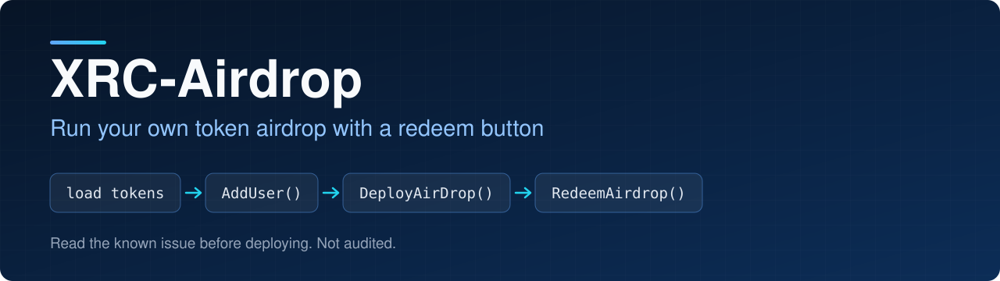
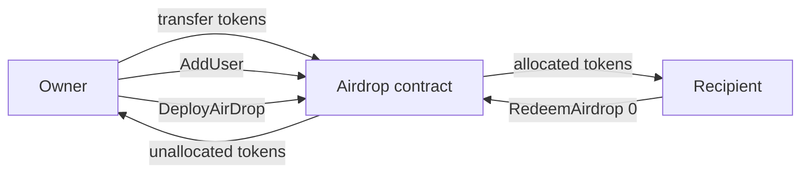

<p align="center">
  
</p>

<p align="center">
  
<a href="https://github.com/CoinClubQuincy/XRC-Airdrop/actions/workflows/build.yml"></a>        
</p>

<p align="center">
  <a href="#how-it-works">How it works</a> · <a href="#try-it">Try it</a> · <a href="#what-is-tested">What is tested</a> · <a href="#known-issues">Known issues</a>
</p>

XRC-Airdrop lets a project distribute its own token without a third-party service. You load tokens into the contract, list who gets what, open the airdrop, and recipients claim from a button on your site.

> [!CAUTION]
> This contract has not been audited and has not run on a real network. Tokens nobody claims stay in the contract for good. See [Known issues](#known-issues).

## How it works




1. Launch your XRC-20 token.
2. Deploy `Airdrop` with a metadata URI and the token address. The deployer receives the owner key.
3. Transfer the airdrop amount to the contract.
4. Call `AddUser(address, amount)` for each recipient.
5. Call `DeployAirDrop(true)`. Unallocated tokens return to the owner and allocated tokens stay for the recipients.
6. Recipients call `RedeemAirdrop(0)`. An address listed more than once receives all of its entries.

`DeployAirDrop(false)` changes nothing, so the owner can keep editing the list. `RemoveUser(index, false)` takes someone off the list before deployment.

## Try it

```bash
git clone https://github.com/CoinClubQuincy/XRC-Airdrop.git
cd XRC-Airdrop
git clone --depth 1 -b v4.9.6 https://github.com/OpenZeppelin/openzeppelin-contracts lib/openzeppelin-contracts
git clone --depth 1 -b v1.9.7 https://github.com/foundry-rs/forge-std lib/forge-std
forge test
```

You need [Foundry](https://getfoundry.sh).

To try it on a network, use the Apothem testnet:

| Network | Chain ID | RPC |
| --- | --- | --- |
| Apothem testnet | 51 | `https://rpc.apothem.network` |
| XDC mainnet | 50 | `https://rpc.xinfin.network` |

```bash
forge create contracts/Airdrop.sol:Airdrop --rpc-url https://rpc.apothem.network --interactive --broadcast --legacy \
  --constructor-args "https://example.com/{id}.json" 0xYourTokenAddress
```

## What is tested

[`test/foundry/Airdrop.t.sol`](test/foundry/Airdrop.t.sol) has 17 tests, including one fuzz test, and runs in CI on every push.

| Tested | Not tested |
| --- | --- |
| Owner-only access, and rejecting a zero address or zero amount | A real network, testnet or mainnet |
| Allocations being capped at the contract balance | An independent security audit |
| Deploying returning only the unallocated tokens | Tokens that charge a fee on transfer |
| `DeployAirDrop(false)` doing nothing, and deploying only once | |
| Redeeming being blocked before deployment, and paying only once | |
| Several entries for one address, removed entries and empty claims | |
| `RemoveUser` refusing an index out of range | |
| Fuzz: claims plus the returned remainder equal the tokens loaded | |

## Changes from earlier versions

Contracts already deployed are unaffected and keep the old behaviour.

- `DeployAirDrop(true)` now works out the remainder when it runs, so it can no longer send allocated tokens back to the owner. The old `RemoveUser` workaround is no longer needed.
- `DeployAirDrop(false)` now does nothing. It used to send tokens anyway.
- `RedeemAirdrop` now pays every entry the caller has from the given index onwards, and returns false when there is nothing to pay.
- `RemoveUser` refuses an index out of range, and `RemoveUser(index, true)` no longer changes anything.
- `AddUser` refuses a zero address and a zero amount. The constructor refuses a zero token address.
- Token transfers use `SafeERC20`, so tokens that do not return a value also work.
- The older Truffle test and tracked build output were removed. Foundry is the supported test path.

## Known issues

| Issue | Effect |
| --- | --- |
| Unclaimed tokens stay locked | After deployment nobody can take back tokens that recipients never claim. Allocate only what you expect to be claimed |
| Tokens sent after deployment are stuck | The contract only returns the remainder once, when it is deployed |
| Fee-on-transfer tokens | The contract assumes it receives and sends the full amount. If a token takes a fee, the last claims can fail |
| Long lists cost more gas | `RedeemAirdrop` scans the list from the given index to the end |

<details>
<summary><strong>More XDC projects</strong></summary>

| Group | Project | What it is |
| --- | --- | --- |
| Standards | [XRC-SHARES](https://github.com/CoinClubQuincy/XRC-SHARES) | Dividend-paying NFT shares and SPLITS for a DApp |
| Standards | [XRCDividendPlus](https://github.com/CoinClubQuincy/XRCDividendPlus) | Dividend-paying XRC-20 token |
| Treasury and finance | [Multi-Sig-Treasury](https://github.com/CoinClubQuincy/Multi-Sig-Treasury) | Treasury controlled by tokenized keys |
| Treasury and finance | [XRC-Credit](https://github.com/CoinClubQuincy/XRC-Credit) | Debt contract skeleton |
| Treasury and finance | [XDC-Defi-Instruments](https://github.com/CoinClubQuincy/XDC-Defi-Instruments) | Assets, agreements, forwards, futures and a marketplace |
| Identity and access | [LoginMFAContract](https://github.com/CoinClubQuincy/LoginMFAContract) | Login with a password and an NFT |
| Identity and access | [PrivateAccessToken](https://github.com/CoinClubQuincy/PrivateAccessToken) | Token-gated contract data demo |
| Identity and access | [Delegated_Authority](https://github.com/CoinClubQuincy/Delegated_Authority) | KYC notary proof of concept |
| Learning and libraries | [XDC-LemonadeStand](https://github.com/CoinClubQuincy/XDC-LemonadeStand) | Workshop DApp built on XRC-SHARES |
| Learning and libraries | [Non-Financial-SmartContracts](https://github.com/CoinClubQuincy/Non-Financial-SmartContracts) | Games, inventory, keys and on-chain repositories |
| Tools | [XDC_Python_SDK_V1](https://github.com/CoinClubQuincy/XDC_Python_SDK_V1) | Python client for the XDC JSON-RPC API |
| Tools | [PrivateXDCNode_SetupScript](https://github.com/CoinClubQuincy/PrivateXDCNode_SetupScript) | Private XDC network setup scripts |
| Tools | [WebApp_to_XDCPay](https://github.com/CoinClubQuincy/WebApp_to_XDCPay) | Web app to XDCPay tutorial |
| Multi-chain | [CoinClub_Framework](https://github.com/CoinClubQuincy/CoinClub_Framework) | Python library with an XDC adapter |
| Interfaces | [Contract_Interface_Model_Language](https://github.com/CoinClubQuincy/Contract_Interface_Model_Language) | Interface documents for smart contracts and APIs |

</details>

## License

[MIT](LICENSE).
